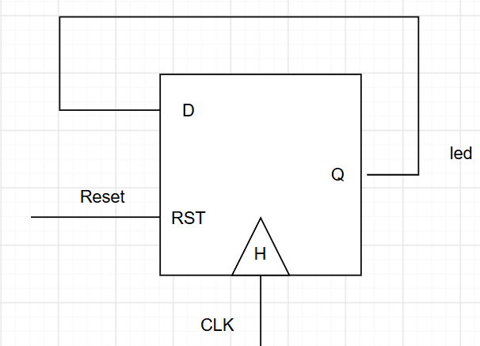
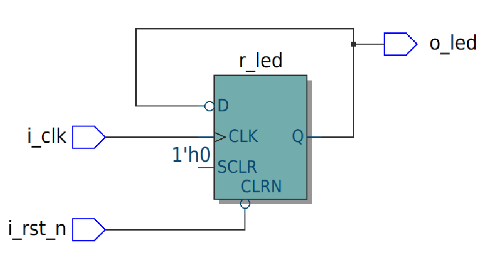
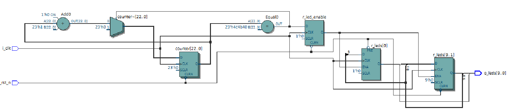

# 2627_2A_FPGA_MALEPART_M-TIR
# 🛠️ Tutoriel Prise en Main FPGA — Quartus Prime & VHDL

Ce dépôt contient le code source VHDL, la configuration des broches (Pin Planner) et les instructions pas à pas pour la prise en main du logiciel **Intel Quartus Prime Lite** et le ciblage d'une carte FPGA Intel / Altera Cyclone V.

---

## 📌 Présentation du TP

L'objectif de ce TP est de se familiariser avec le flux de conception FPGA :
1. Configuration de l'environnement sous **Quartus Prime Lite v24.1**.
2. Synthèse et affectation des broches I/O (*Pin Planner*).
3. Programmation de la cible via le programmateur **USB Blaster II**.
4. Implémentation d'un composant combinatoire simple (allumage d'une LED par bouton poussoir).
5. Conception séquentielle : division de fréquence d'horloge pour le clignotement d'une LED.
6. Conception et programmation d'un **chenillard**.
7. Conclusion

---

## 🔌 Matériel & Prérequis

### Logiciels
- **Quartus Prime Lite Edition v24.1** (gratuit, disponible sur Windows et Linux).
- *(Simulation préalable : ModelSim)*.

### Carte FPGA & Composants
- **FPGA cible :** Cyclone V — `5CSEBA6U23I7`
- **Programmation :** Port USB dédié **USB BLASTER II** (situé côté alimentation & HDMI).


---

## 🚀 Étapes de Configuration du Projet
Lors de la création du fichier on sélectionne le FPGA **`5CSEBA6U23I7`** *(on fait attention à ne pas choisir les variantes L ou S)*.
</details>


---


### Exercice 1 : Contrôle Combinatoire Simple (`tuto_fpga.vhd`)

On exécute le code fourni par le tp. Dans le cadre d'un tuto, l'objectif de ce code est de simplement allumé une LED lorsque le bouton poussoir est maintenu.
Pour faire allumer la LED, on se rend dans le PIN Planner afin d'assigner chaque sortie et entrée à une Pin de la carte. Une fois fait on compile le programme puis on l'implémente dans la carte.

---


### Exercice 2 : Logique séquentielle et division d'horloge (`led_blink.vhd`)

On exécute le code fourni par le tp. On réalise d'abord un schéma théorique puis par la suite un autre avec RTL:

Schéma théorique: 



Schéma RTL:


On compile le programme et on remarque que la led ne clignote pas ! .
On va donc modifier le code pour que l'on puisse visualiser le clignotement de la LED en ajoutant une horloge qui va être gérer par un process:

```vhdl
library ieee;
use ieee.std_logic_1164.all;

entity led_blink is
    port (
        i_clk   : in std_logic;
        i_rst_n : in std_logic;
        o_led   : out std_logic
    );
end entity led_blink;

architecture rtl of led_blink is
    signal r_led        : std_logic := '0';
    signal r_led_enable : std_logic := '0';
begin

    process(i_clk, i_rst_n)
        variable counter : natural range 0 to 5000000 := 0;
    begin
        if (i_rst_n = '0') then
            counter := 0;
            r_led_enable <= '0';
        elsif (rising_edge(i_clk)) then
            if (counter = 5000000) then
                counter := 0;
                r_led_enable <= '1';
            else
                counter := counter + 1;
                r_led_enable <= '0';
            end if;
        end if;
    end process;
    
    process(i_clk, i_rst_n)
    begin
        if (i_rst_n = '0') then
            r_led <= '0';
        elsif (rising_edge(i_clk)) then
            if (r_led_enable = '1') then
                r_led <= not r_led;
            end if;
        end if;
    end process;

    o_led <= r_led;

end architecture rtl;
```
On réalise le schéma théorique:


Puis un autre avec RTL :


Une fois fait on assigne les PIN de l'horloge et du reset dans le PIN PLanner et on compile. On implémente le programme et on peut désormais visualiser le clignotement.

### Exercice 3 : Conception et programmation d'un **chenillard**

On souhaite désormais faire un chenillard, pour cela on va utiliser le code précédent afin de la réaliser, tous en le modidian:
```vhdl
library ieee;
use ieee.std_logic_1164.all;

entity led_blink is
    port (
        i_clk   : in  std_logic;
        i_rst_n : in  std_logic;
        o_leds  : out std_logic_vector(9 downto 0)
    );
end entity led_blink;

architecture rtl of led_blink is
    constant CLK : integer := 5000000;
    signal r_leds : std_logic_vector(9 downto 0) := "0000000001";
    signal r_led_enable : std_logic := '0';

begin
   process(i_clk, i_rst_n)
        variable counter : natural range 0 to CLK;
    begin
        if (i_rst_n = '0') then
            counter := 0;
            r_led_enable <= '0';
        elsif (rising_edge(i_clk)) then
            if (counter = CLK) then
                counter := 0;
                r_led_enable <= '1';
            else
                counter := counter + 1;
                r_led_enable <= '0';
            end if;
        end if;
    end process;

    process(i_clk, i_rst_n)
    begin
        if (i_rst_n = '0') then
            r_leds <= "0000000001";
        elsif rising_edge(i_clk) then
            if (r_led_enable = '1') then
                r_leds <= r_leds(8 downto 0) & r_leds(9);
            end if;
        end if;
    end process;

    o_leds <= r_leds;
end architecture rtl;
```
Par exemple, dans ce code nous avons remplacé la led qui etait en std_logic pour la faire passer en std_logic_vector afin de pouvoir commander 10 leds et faire incrémenter les leds du chenillard.

On a récupéré le schéma bloc:


Puis assigner les pins a toute les leds:

### LEDs
| Nom  | GPIO  | FPGA |
| :--- |:-----:| ----:|
| LED0 | J1:5  | AG28 |
| LED1 | J1:7  | AE25 |
| LED2 | J1:9  | AG26 |
| LED3 | J1:13 | AG25 |
| LED4 | J1:17 | AG23 |
| LED5 | J1:21 | AH21 |
| LED6 | J1:25 | AF22 |
| LED7 | J1:27 | AG20 |
| LED8 | J1:33 | AG18 |
| LED9 | J1:37 | AG15 |

Enfin on a compiler et implémenter le programme ainsi que visualiser le chenillard sur la carte.


# TP FPGA – Mise en œuvre du contrôleur HDMI

## 1. Objectif du TP

L’objectif de cette partie du TP est de mettre en œuvre le contrôleur HDMI développé lors du TD précédent afin de générer un signal vidéo à partir du FPGA.

Le contrôleur HDMI permet de produire les signaux nécessaires à l’affichage d’une image sur un écran. Il génère notamment les coordonnées des pixels ainsi que les signaux de synchronisation horizontale et verticale.

Cette étape constitue une première mise en œuvre de l’affichage vidéo sur la carte FPGA DE10-Nano. Elle servira de base pour les étapes suivantes du projet, notamment le déplacement et la mémorisation d’un pixel dans le cadre de la réalisation d’un écran magique numérique.

## 2. Principe de fonctionnement

Le contrôleur HDMI repose sur le balayage de l’écran pixel par pixel. Chaque pixel est identifié par deux coordonnées :

- `x` : position horizontale du pixel ;
- `y` : position verticale du pixel.

Ces coordonnées sont générées par des compteurs internes au contrôleur HDMI. Elles permettent de déterminer la couleur à afficher à chaque position de l’écran.

Le contrôleur fournit également les signaux de synchronisation nécessaires au respect des timings vidéo.

Le signal de sortie `o_hdmi_tx_d` représente la couleur du pixel courant. Il est constitué de 24 bits, répartis entre les trois composantes de couleur :

| Composante   | Bits           |
| ------------ | -------------- |
| Rouge (Red)  | `23 downto 16` |
| Vert (Green) | `15 downto 8`  |
| Bleu (Blue)  | `7 downto 0`   |

Chaque composante est codée sur 8 bits, ce qui permet de représenter 256 niveaux d’intensité par couleur.

## 3. Simulation du contrôleur HDMI

Avant l’intégration sur la carte FPGA, le contrôleur HDMI a été simulé à l’aide de l’environnement de simulation utilisé lors du TD 3.

La simulation permet de vérifier le fonctionnement du composant et de contrôler la conformité des signaux temporels.

Les principaux éléments observés sont :

- l’évolution des compteurs de coordonnées ;
- la synchronisation horizontale ;
- la synchronisation verticale ;
- les signaux associés à l’affichage des pixels.

Les timings obtenus doivent correspondre à ceux définis lors du TD 3. Cette vérification est importante, car un décalage temporel peut entraîner un affichage incorrect sur l’écran.

## 4. Intégration du contrôleur HDMI

Une fois la simulation validée, le fichier `hdmi_controler.vhd` est ajouté au projet Quartus.

Le composant est ensuite instancié dans le fichier principal `telecran.vhd`.

Les signaux d’horloge et de reset sont récupérés à partir de la PLL du projet :

```vhdl
i_clk   => s_clk_27,
i_rst_n => s_rst_n,
```

Les signaux non utilisés lors de cette étape sont laissés ouverts :

```vhdl
o_pixel_en      => open,
o_pixel_address => open,
```

Cette instanciation permet de relier le contrôleur HDMI au reste du système.

Le contrôleur utilise son horloge pour faire évoluer les coordonnées des pixels et générer les signaux nécessaires à l’affichage.

## 5. Génération des couleurs à partir des coordonnées

Afin de vérifier le fonctionnement du contrôleur HDMI, les coordonnées des pixels sont utilisées pour générer une image simple.

Les coordonnées horizontales et verticales sont converties en valeurs binaires sur 8 bits, puis affectées aux composantes rouge et verte du signal vidéo.

```vhdl
o_hdmi_tx_d(23 downto 16) <=
    std_logic_vector(to_unsigned(s_x_counter, 8));

o_hdmi_tx_d(15 downto 8) <=
    std_logic_vector(to_unsigned(s_y_counter, 8));

o_hdmi_tx_d(7 downto 0) <= (others => '0');
```

Dans cette configuration :

- la composante rouge dépend de la coordonnée horizontale ;
- la composante verte dépend de la coordonnée verticale ;
- la composante bleue est fixée à zéro.

Ainsi, la couleur affichée varie en fonction de la position du pixel sur l’écran.

Cette méthode permet de visualiser directement le balayage horizontal et vertical généré par le contrôleur HDMI.


## Conclusion
Durant ce TP, nous sommes parvenu a correctement prendre en main le logiciel Quartus, faire analyser, assigner et compiler le programme et le visualiser sur la carte


---


