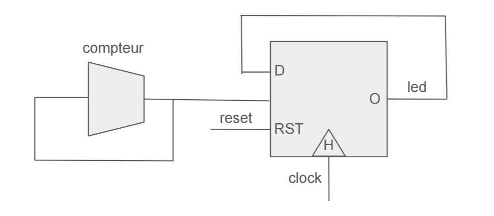
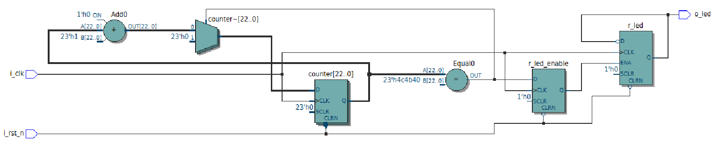
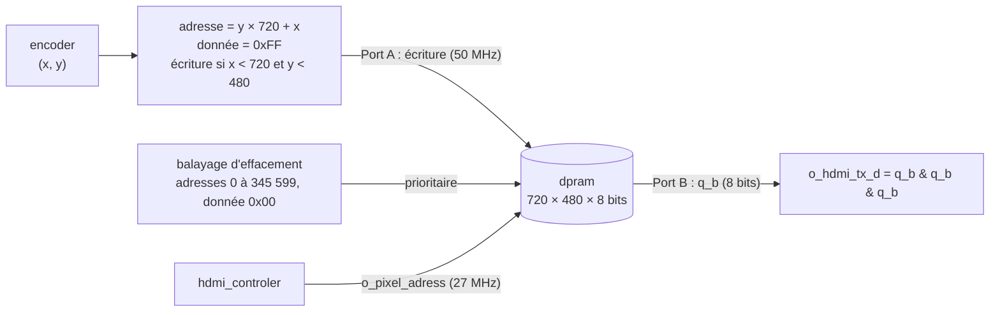

# 🖥️ FPGA 2A — Prise en main Quartus Prime, VHDL & projet Télécran

Dépôt du module **FPGA** (2ᵉ année, 2026-2027). Il regroupe :

- les travaux pratiques de prise en main de **Intel Quartus Prime Lite** et du **VHDL** (LED, clignotement, chenillard) ;
- le **projet Télécran** : deux encodeurs rotatifs pilotent un point qui dessine sur un écran **HDMI**, le dessin étant mémorisé dans une **RAM double port** et effaçable par un bouton.

---

## 📑 Sommaire

- [Matériel et prérequis](#-matériel-et-prérequis)
- [Structure du dépôt](#-structure-du-dépôt)
- [Démarrage rapide](#-démarrage-rapide)
- [TP1 : prise en main de Quartus](#-tp1--prise-en-main-de-quartus)
- [Projet Télécran](#-projet-télécran)
- [Simulation](#-simulation)
- [Conclusion](#-conclusion)
- [Auteurs](#-auteurs)

---

## 🔌 Matériel et prérequis

### Logiciels

| Outil | Version | Usage |
|-------|---------|-------|
| Intel Quartus Prime Lite | 24.1 | Synthèse, placement-routage, programmation |
| ModelSim / QuestaSim | — | Simulation |

Quartus Prime Lite est gratuit et disponible sous Windows et Linux.

### Carte et périphériques

- **Carte :** **DE10-Nano** — FPGA cible Cyclone V `5CSEBA6U23I7`
  > ⚠️ Bien sélectionner cette référence et non les variantes **L** ou **S**.
- **Programmation :** port USB dédié **USB Blaster II** (côté alimentation et HDMI).
- **Projet Télécran :** sortie **HDMI** de la carte et carte mezzanine **TELECRAN** (2 encodeurs rotatifs avec bouton poussoir intégré).
- **Visualisation HDMI en salle de TP :** adaptateur HDMI → USB et logiciel **VLC** (*Média → Ouvrir un périphérique de capture*).

---

## 📂 Structure du dépôt

```
.
├── TP/                        # encoder.vhd (version du TP)
├── TP1/                       # TP1 : LED, clignotement, chenillard
│   └── Capture/               #   schémas théoriques et RTL (images du README)
├── Projet telecran sim/       # Simulation ModelSim de l'encodeur (encoder_tb.vhd, encoder.do)
├── Capture simulation/        # Chronogramme de simulation + photo de l'image de test HDMI
├── telecran/                  # ✅ Projet Quartus du Télécran (version complète)
├── Projet_telecran/telecran/  # Version antérieure du projet (sans hdmi_controler.vhd)
└── README.md
```

### Fichiers du projet Télécran (`telecran/`)

| Fichier | Rôle |
|---------|------|
| [`telecran.vhd`](telecran/telecran.vhd) | Entité principale : relie PLL, HDMI, encodeurs, RAM et effacement |
| [`encoder.vhd`](telecran/encoder.vhd) | Décodage de deux encodeurs en quadrature → coordonnées X et Y |
| [`hdmi_controler.vhd`](telecran/hdmi_controler.vhd) | Génération des signaux de synchronisation HDMI et des coordonnées de pixel |
| [`dpram.vhd`](telecran/dpram.vhd) | Mémoire double port 720 × 480 × 8 bits (mémoire d'image) |
| [`i2c/`](telecran/i2c) | Configuration I2C du transmetteur HDMI ([`I2C_HDMI_Config.v`](telecran/i2c/I2C_HDMI_Config.v), …) |
| [`pll/`](telecran/pll) | PLL générant l'horloge pixel de 27 MHz à partir de l'horloge 50 MHz |
| [`telecran.qsf`](telecran/telecran.qsf) / [`.sdc`](telecran/telecran.sdc) | Affectation des broches et contraintes de timing |

---

## 🚀 Démarrage rapide

1. Cloner le dépôt :
   ```bash
   git clone https://github.com/neku89123/2627_2A_FPGA_MALEPART_M-TIR.git
   ```
2. Ouvrir dans **Quartus Prime Lite 24.1** le projet voulu :
   - Télécran : `telecran/telecran.qpf`
   - TP1 : `TP1/TP1_tuto_FPGA.qpf`
3. Compiler (**Processing → Start Compilation**).
4. Brancher la carte sur le port **USB Blaster II**.
5. Programmer via **Tools → Programmer** avec le fichier `.sof` généré.

---

## 🧪 TP1 : prise en main de Quartus

Objectifs : configurer l'environnement, affecter les broches I/O, programmer la cible, puis passer de la logique combinatoire à la logique séquentielle.

### Exercice 1 : contrôle combinatoire ([`TP1_tuto_FPGA.vhd`](TP1/TP1_tuto_FPGA.vhd))

Une LED s'allume tant que le bouton poussoir est maintenu :

```vhdl
led0 <= pushl;
```

Les entrées et sorties sont affectées aux broches de la carte dans le **Pin Planner**, puis le projet est compilé et implémenté.

### Exercice 2 : division d'horloge ([`led_blink.vhd`](TP1/led_blink.vhd))

Une première version, sans division d'horloge, compile mais la LED **ne clignote pas de façon visible** : la fréquence est trop élevée pour l'œil. On ajoute donc un compteur qui génère un signal d'autorisation (`r_led_enable`) à fréquence réduite ; la LED change d'état à chaque impulsion.

```vhdl
process(i_clk, i_rst_n)
    variable counter : natural range 0 to 5000000 := 0;
begin
    if (i_rst_n = '0') then
        counter := 0;
        r_led_enable <= '0';
    elsif (rising_edge(i_clk)) then
        if (counter = 5000000) then
            counter := 0;
            r_led_enable <= '1';
        else
            counter := counter + 1;
            r_led_enable <= '0';
        end if;
    end if;
end process;
```

Il faut aussi assigner les broches d'**horloge** et de **reset** dans le Pin Planner.

**Version sans division d'horloge** : on réalise d'abord un schéma théorique, puis on regarde le schéma RTL généré par Quartus. La LED ne clignote pas visiblement.

| Schéma théorique | Schéma RTL |
|:---:|:---:|
|  |  |

**Version avec compteur (division d'horloge)** : le clignotement devient visible.

| Schéma théorique | Schéma RTL |
|:---:|:---:|
|  |  |

### Exercice 3 : chenillard

La LED unique (`std_logic`) devient un vecteur de 10 LEDs (`std_logic_vector(9 downto 0)`). À chaque impulsion de `r_led_enable`, le bit allumé se décale d'un cran :

```vhdl
r_leds <= r_leds(8 downto 0) & r_leds(9);
```

Schéma bloc obtenu :


**Affectation des broches des LEDs :**

| Nom  | GPIO  | FPGA |
|------|-------|------|
| LED0 | J1:5  | AG28 |
| LED1 | J1:7  | AE25 |
| LED2 | J1:9  | AG26 |
| LED3 | J1:13 | AG25 |
| LED4 | J1:17 | AG23 |
| LED5 | J1:21 | AH21 |
| LED6 | J1:25 | AF22 |
| LED7 | J1:27 | AG20 |
| LED8 | J1:33 | AG18 |
| LED9 | J1:37 | AG15 |

---

## 🎨 Projet Télécran

### Principe

```
 Encodeur gauche ─┐                                   ┌─► Port B (lecture, 27 MHz) ─► HDMI
                  ├─► encoder ─► (x, y) ─► dpram ─────┘
 Encodeur droit  ─┘     │          Port A (écriture, 50 MHz)
                        └─► LEDs             ▲
 Bouton rst ─► balayage d'effacement ────────┘
```

- L'**encodeur gauche** fait varier **X**, l'**encodeur droit** fait varier **Y**.
- À chaque position, un pixel blanc (`0xFF`) est écrit dans la mémoire : le tracé **reste affiché**.
- Le contrôleur HDMI lit en permanence la mémoire pour afficher l'image en niveaux de gris (la valeur 8 bits est répétée sur les canaux R, G et B).

### 1. Encodeurs ([`encoder.vhd`](telecran/encoder.vhd))

Cette partie met l'affichage de côté et se concentre sur les **deux encodeurs rotatifs**. Le composant [`encoder`](telecran/encoder.vhd) incrémente un compteur quand on tourne l'encodeur vers la droite et le décrémente quand on le tourne vers la gauche. L'encodeur gauche donne la coordonnée **X** (`o_x`), l'encodeur droit la coordonnée **Y** (`o_y`).

#### Signaux en quadrature

Un encodeur fournit deux signaux **A** et **B** décalés d'un quart de période. L'ordre dans lequel A et B changent d'état indique le sens de rotation :

| Action | Condition |
|--------|-----------|
| Incrément | front montant de A avec B bas, **ou** front descendant de A avec B haut |
| Décrément | front montant de B avec A bas, **ou** front descendant de B avec A haut |

#### Détection de front

Chaque signal est échantillonné par deux bascules D en série. `q1` est la valeur courante et `q2` la valeur précédente. Un front est détecté quand les deux valeurs diffèrent :

```
        ┌─────┐  q1  ┌─────┐  q2
 A ────►│ D Q ├──┬──►│ D Q ├──┐
        └──▲──┘  │   └──▲──┘  │
       clk_enable │  clk_enable│
                  ▼            ▼
   front montant    =  q1 ET (NON q2)
   front descendant =  (NON q1) ET q2
```

```vhdl
a_lrising  <= a_lq1 and not a_lq2;   -- front montant de A (encodeur gauche)
a_lfalling <= not a_lq1 and a_lq2;   -- front descendant de A
```

#### Échantillonnage à 1 kHz

Un prescaler divise l'horloge 50 MHz par 50 000 (`CLK_DIV_FACTOR`) et produit l'impulsion `clk_enable` à **1 kHz**. Les entrées A et B ne sont échantillonnées qu'à cette cadence, ce qui filtre les rebonds mécaniques des encodeurs.

#### Comptage

Pour chaque encodeur, un compteur 10 bits est mis à jour avec les conditions du tableau ci-dessus :

```vhdl
if (a_lrising and not b_lq2) = '1' or (a_lfalling and b_lq2) = '1' then
    counter_left <= counter_left + 1;
elsif (b_lrising and not a_lq2) = '1' or (b_lfalling and a_lq2) = '1' then
    counter_left <= counter_left - 1;
end if;
```

#### Interface

| Port | Sens | Rôle |
|------|------|------|
| `clk`, `reset` | entrée | Horloge 50 MHz et reset (actif à l'état bas) |
| `A_left`, `B_left` | entrée | Voies A et B de l'encodeur gauche |
| `A_right`, `B_right` | entrée | Voies A et B de l'encodeur droit |
| `o_x` | sortie | Valeur du compteur gauche → coordonnée X |
| `o_y` | sortie | Valeur du compteur droit → coordonnée Y |
| `o_leds` | sortie (`N` bits) | 4 bits de poids faible de chaque compteur, pour le débogage sur LEDs |

Le paramètre générique `N` (8 par défaut) fixe la largeur du vecteur `o_leds`.

> ℹ️ Le compteur 10 bits repasse de 0 à 1023 quand on décrémente sous zéro. Comme l'écran ne fait que 720 × 480, l'écriture en mémoire n'a lieu que si `x < 720` et `y < 480` : en dehors de l'écran, le point n'est pas tracé.

Le composant est validé par simulation : voir la section [Simulation](#-simulation) et son chronogramme.

### 2. Contrôleur HDMI ([`hdmi_controler.vhd`](telecran/hdmi_controler.vhd))

Résolution **720 × 480**, horloge pixel **27 MHz** fournie par la PLL. Le contrôleur génère `hs`, `vs`, `de` ainsi que les coordonnées `x`, `y` et l'adresse du pixel courant (`y × 720 + x`).

| Paramètre | Horizontal | Vertical |
|-----------|-----------|----------|
| Zone active | 720 | 480 |
| Synchro | 61 | 5 |
| Front porch | 58 | 30 |
| Back porch | 18 | 9 |

#### À quels bits correspond chaque composante couleur ?

Le signal `o_hdmi_tx_d` est un vecteur de **24 bits** au format **RGB 8-8-8** : chaque composante est codée sur 8 bits (valeurs de 0 à 255).

| Bits | Composante |
|------|-----------|
| `23 downto 16` | Rouge |
| `15 downto 8` | Vert |
| `7 downto 0` | Bleu |

Pour valider le contrôleur, une image de test a d'abord été générée à partir des coordonnées :

```vhdl
o_hdmi_tx_d(23 downto 16) <= std_logic_vector(to_unsigned(s_x_counter, 8)); -- rouge
o_hdmi_tx_d(15 downto 8)  <= std_logic_vector(to_unsigned(s_y_counter, 8)); -- vert
o_hdmi_tx_d(7 downto 0)   <= (others => '0');                               -- bleu
```

Résultat sur l'écran : la composante rouge croît avec X et la verte avec Y. Les valeurs étant tronquées sur 8 bits, le dégradé se répète (≈ 3 fois horizontalement et 2 fois verticalement) :


Dans la version finale de [`telecran.vhd`](telecran/telecran.vhd), la valeur 8 bits lue en mémoire est recopiée sur les trois composantes (`q_b & q_b & q_b`) : le pixel est donc **noir** (`0x00`) ou **blanc** (`0xFF`).

### 3. Mémorisation ([`dpram.vhd`](telecran/dpram.vhd))

Pour conserver le dessin, les pixels parcourus sont stockés dans un **framebuffer** : une mémoire de 720 × 480 = 345 600 mots de 8 bits.

#### Qu'est-ce qu'une mémoire dual-port ?

Une mémoire **dual-port** est une RAM équipée de **deux ports d'accès indépendants**. Chaque port a sa propre adresse, sa propre donnée, son propre signal d'écriture et sa propre horloge. Les deux ports peuvent fonctionner **en même temps** : on peut par exemple écrire à une adresse par le port A pendant qu'on lit une autre adresse par le port B. Une mémoire simple port ne permet qu'un seul accès à la fois.

Ici c'est indispensable : l'affichage doit lire un pixel à chaque cycle de l'horloge 27 MHz sans interruption, alors que les écritures arrivent à n'importe quel moment, au rythme des encodeurs, sur l'horloge 50 MHz. Deux horloges différentes et des accès simultanés : le dual-port évite tout arbitrage et tout trou dans l'image.

| Port | Horloge | Rôle |
|------|---------|------|
| A | 50 MHz | Écriture du pixel dessiné (ou de l'effacement) |
| B | 27 MHz | Lecture par le contrôleur HDMI pour l'affichage (`we_b = '0'`) |

#### Schéma de mémorisation des pixels



Principe :

1. Les coordonnées `(x, y)` des encodeurs sont converties en adresse mémoire `y × 720 + x`.
2. Le port A écrit `0xFF` à cette adresse : le pixel est allumé, et il le reste.
3. En parallèle, le contrôleur HDMI fournit l'adresse du pixel à afficher (`o_pixel_adress`) au port B.
4. La valeur lue (`q_b`) est envoyée sur les trois composantes de `o_hdmi_tx_d`.

Le composant [`dpram`](telecran/dpram.vhd) est instancié dans [`telecran.vhd`](telecran/telecran.vhd) avec ces connexions.

### 4. Effacement

Dans [`telecran.vhd`](telecran/telecran.vhd), le bouton poussoir de l'**encodeur droit** (`RIGHT_PB`, signal `rst`, actif à l'état bas) lance un **balayage de toute la mémoire** : l'adresse est incrémentée à chaque cycle d'horloge et la valeur `0x00` est écrite partout. Un multiplexeur donne la priorité à l'effacement sur le dessin tant que le balayage est en cours (≈ 345 600 cycles). Le même balayage est exécuté au démarrage.

### 5. Broches principales

| Signal VHDL | Nom carte | Broche FPGA |
|-------------|-----------|-------------|
| `i_clk_50` | Horloge 50 MHz | PIN_V11 |
| `i_rst_n` | Reset | PIN_AH17 |
| `i_left_ch_a` | LEFT_A (J1:8) | PIN_AF27 |
| `i_left_ch_b` | LEFT_B (J1:6) | PIN_AF28 |
| `i_left_pb` | LEFT_PB (J1:10) | PIN_AH27 |
| `i_right_ch_a` | RIGHT_A (J2:38) | PIN_AA26 |
| `i_right_ch_b` | RIGHT_B (J2:39) | PIN_AA13 |
| `rst` (effacement) | RIGHT_PB (J2:40) | PIN_AA11 |

Les LEDs de la carte mezzanine utilisent les mêmes broches que dans le tableau du TP1. J2 correspond à GPIO0 et J1 à GPIO1.

> 🚧 *À compléter : photos du résultat sur la carte (déplacement du pixel, tracé mémorisé, effacement).*

---

## 🔬 Simulation

Le dossier `Projet telecran sim/` contient la simulation de l'encodeur sous ModelSim :

```tcl
# Depuis ModelSim, dans le dossier "Projet telecran sim"
do encoder.do
```

Le script ([`encoder.do`](Projet%20telecran%20sim/encoder.do)) compile [`encoder.vhd`](Projet%20telecran%20sim/encoder.vhd) et le banc de test [`encoder_tb.vhd`](Projet%20telecran%20sim/encoder_tb.vhd). Il crée la bibliothèque `work`, lance la simulation, affiche les signaux des deux encodeurs ainsi que `o_x`, `o_y` et `o_leds`, puis exécute 10 µs.


Lecture du chronogramme :

- La séquence sur `A_left` / `B_left` fait **incrémenter** `o_x` : 0 → 1 → 2.
- La séquence sur `B_right` / `A_right` fait **décrémenter** `o_y` : 0 → 1023 → 1022. Le compteur 10 bits **repasse par 1023** en passant sous zéro.
- `o_leds` regroupe les 4 bits de poids faible de chaque compteur (`o_y` puis `o_x`) : `01`, `02`, `F2`, `E2`.

---

## 📚 Ressources

- Énoncé du TP (ENSEA) : [fpga_tp.md](https://github.com/lfiack/ENSEA_2A_FPGA_Public/blob/main/mineure/3-tp/fpga_tp.md)
- Principe du télécran : [Écran magique (Wikipédia)](https://fr.wikipedia.org/wiki/%C3%89cran_magique)

---

## ✅ Conclusion

Ces travaux ont permis de prendre en main Quartus Prime (analyse, affectation des broches, compilation, programmation, vérification sur la carte), puis de réaliser un système complet : lecture de capteurs, affichage HDMI, mémorisation d'image et effacement.

---

## 👥 Auteurs

Projet réalisé par Alexandre MALEPART et Wissem MTIR dans le cadre du module FPGA, 2ᵉ année (2026-2027).
